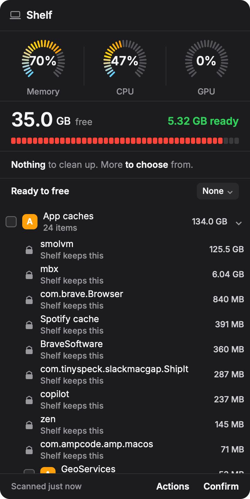
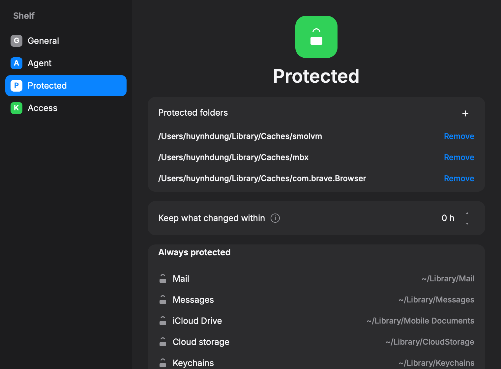
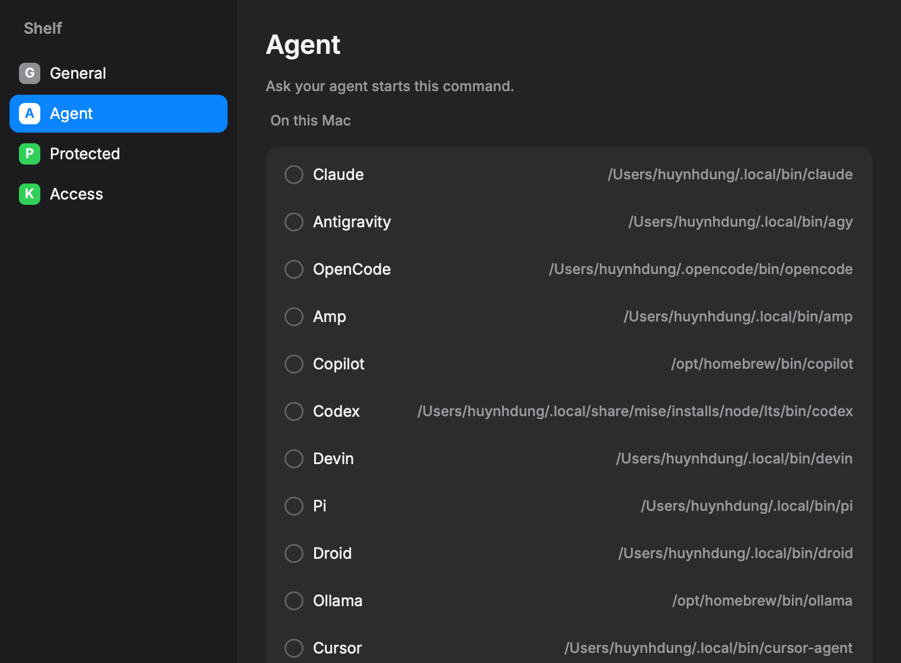

# Welcome to Shelf 👋


[](https://github.com/jellydn/shelf/blob/main/LICENSE)
[](https://twitter.com/jellydn)

> A macOS menu-bar review of what a cleanup would free. Confirm records the choice and deletes nothing.

## Screenshot

The panel opens from the menu bar.



Protected folders, the hour hold, and the locked system paths.



Agents that are on `PATH`.



## Features

- Menu-bar panel with Memory, CPU, and GPU
- Free space, ready space, and a capacity bar
- Careful, Balanced, and Aggressive choices, plus a Selected override
- One summary line for what the choice would free
- Actions for the row under the pointer: Finder, keep, unlock, and the rest
- Protected folders you add, a “keep what changed within” hold, and built-in locked paths
- AI tools detected on `PATH`, from the same command list as [ai-launcher](https://github.com/jellydn/ai-launcher)
- Ask Agent sends the current ticked selection, sizes, and cleanup request to the tool chosen in Settings, only after you grant access. Folder paths are sent only when path sharing is enabled; destructive work needs approval.
- Settings and the panel are never open together

## Ask Agent

Each request creates a private folder under `~/Library/Application Support/Shelf/Runs/` with `Ask.command` and `context.md`. Earlier runs are kept, not overwritten. The context records the eligible ticked items at the time of the request; later selection changes do not change that snapshot.

Ask Agent runs the configured Grok or Antigravity CLI through ACP on a background thread. Shelf requires the agent's plan mode before sending the request. Other agents show an unsupported-provider message; Shelf does not switch agents or guess their flags. The panel shows elapsed progress and Cancel, then the review or an inline error. Details shows redacted diagnostics, with Agent settings and Retry. Errors do not clear scan results or change ticks.

With path sharing off, Shelf sends only the saved selection context. With sharing on, Shelf permits bounded text reads and directory listings for eligible selected folders. Its ACP callbacks reject writes, terminal commands, unselected paths, protected/kept/held/in-use paths, and symlink escapes. Selection or permission changes can only reduce the original read scope. The CLI must also honour its own sandbox and plan mode; Shelf's callbacks are not an independent operating-system sandbox.

After a successful review, Shelf saves `analysis.md` and `session.txt`. Terminal opens `Ask.command` to resume that exact provider session in the same run folder. Before success, the launcher refuses to open an unrelated fresh chat. Terminal runs under the CLI's own plan/sandbox controls, not Shelf's ACP read filter. The saved context is a snapshot, not a live selection.

Agent-start permission still applies. Requests remain manual; there are no automatic paid calls. Destructive work requires separate approval, and Shelf itself never deletes files. Run files can contain shared paths and remain on disk until you remove them. On this Mac, the installed Grok read-only sandbox currently refuses startup because of a socket-symlink deny-list error; Shelf reports it rather than disabling the sandbox. Live model analysis and native session continuation have not been verified; harmless protocol stubs cover the handoff.

## Prerequisites

- macOS
- Rust, pinned in `rust-toolchain.toml`

## Install

For Apple Silicon Macs running macOS 14 or later:

```sh
brew install --cask jellydn/tap/shelf
```

If Homebrew refuses to load an untrusted third-party cask, review `jellydn/homebrew-tap` and run `brew trust --cask jellydn/tap/shelf`, then retry installation. This trusts only Shelf, not every entry in the tap. Older Homebrew versions may not require this step.

Or download the DMG or ZIP from [Releases](https://github.com/jellydn/shelf/releases/latest). The app is ad-hoc signed, not notarised. If macOS blocks the first launch, use **System Settings → Privacy & Security → Open Anyway**. Intel builds are not provided yet.

To build from source:

```sh
git clone https://github.com/jellydn/shelf
cd shelf
sh scripts/bundle.sh
open target/release/Shelf.app
```

Copy `target/release/Shelf.app` to Applications if you want to keep it there. The bundle uses `io.github.jellydn.shelf` as its stable identifier and `LSUIElement` to stay out of the Dock. The build script signs it ad hoc for local use; it is not a notarised release.

The archivebox icon appears before the disk scan finishes. Click it to open the panel. Click it again, or move the pointer outside the panel, to close it. On macOS 27, the panel uses AppKit's expanded-interface session; older systems use the button action.

The first scan and system gauge commands run on background threads. Memory, CPU, and GPU update about once a second. GPU load comes from the driver's IOKit performance statistics, with renderer/tiler values as a fallback when device utilisation is unavailable. A driver that exposes no load still shows 0%.

For development, `cargo run --release` still works without building a bundle.

CI checks formatting, Clippy, and the full test suite, then uploads packaged test apps. A `v*` tag matching `Cargo.toml` runs the release workflow and publishes an Apple Silicon DMG, ZIP, and `SHA256SUMS`. Packaging follows [Oak's](https://github.com/jellydn/oak) ad-hoc sign/verify-before-archive approach. Update `RELEASE_NOTES.md` before each release. The Homebrew tap checks for published stable releases every six hours and can also be updated manually.

Open Settings from Actions, or with Command-,. The panel closes. Click the menu-bar icon to close Settings and open the panel.

Choose **Quit Shelf** in Actions, or press Command-Q in the panel or Settings, to exit the app.

## Run tests

```sh
cargo test
```

A headless picture of the panel:

```sh
cargo run -- --theme dark --snap shots/tray.png
```

## Author

👤 **Huynh Duc Dung**

- Website: https://productsway.com/
- Twitter: [@jellydn](https://twitter.com/jellydn)
- Github: [@jellydn](https://github.com/jellydn)

## Show your support

[](https://ko-fi.com/dunghd)
[](https://paypal.me/dunghd)
[](https://www.buymeacoffee.com/dunghd)

Give a ⭐️ if this project helped you!

[](https://github.com/jellydn/shelf/stargazers)
