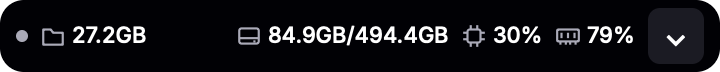
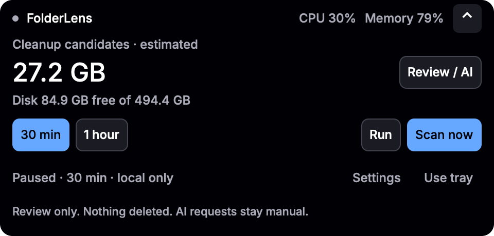

# FolderLens


A notch-first macOS app for reviewing cleanup candidates, disk space and system usage, with optional agent analysis and a menu-bar fallback.

**Record choice records a selection in memory. It never deletes files or runs cleanup.** Sizes are estimates, not reclaimed space.

FolderLens is the new name for Shelf, starting with **0.2.1**. Quick review, folder protections, manual agent help and publisher-verified update checks remain available. The [codebase map](.planning/codebase/ARCHITECTURE.md) documents the pre-rename source.


## Install

Apple Silicon, macOS 14+. Get the DMG or ZIP containing `FolderLens.app` from the [0.3.0 stable release](https://github.com/jellydn/folderlens/releases/tag/v0.3.0) and check `SHA256SUMS`. Builds are ad-hoc signed, **not notarized**; macOS may require **Privacy & Security → Open Anyway**. Publisher signatures are not Apple approval.

Or install the stable release through Homebrew. Version 0.2.1 and later install `FolderLens.app`; older cask versions installed `Shelf.app`. The cask checks for new stable versions every six hours, so it can lag behind a new release. Run `brew update` first.

```sh
brew install --cask jellydn/tap/folderlens
```

For Homebrew trust or source builds, see the [guide](docs/guide.md#install). Existing Shelf users must follow the [migration guide](docs/guide.md#migrating-from-shelf); the old updater cannot accept FolderLens-named releases.

## Use

1. Expand the notch and choose **Review / AI**, or click the menu-bar archivebox. Choose a preset or eligible folders; review reasons and exclusions.
2. **Record choice** records without deleting. Selection changes clear the record.
3. For **Ask Agent**, configure **Settings → Agent / Access**. Requests are manual; provider costs and data policies apply.

### Notch and local checks

The app starts with an Oak-style notch, centered below the primary display's
camera/menu-bar area. The single-line 360×36 compact view uses icons for candidate estimates, disk
free/total space, CPU and memory usage, plus a scan-status dot. Expand it for Scan now,
30-minute/1-hour checks and Run/Pause. CPU and memory follow General settings.
**Review / AI** opens the full folder review; closing Review returns to the notch.
**Use tray** hides the notch. The archivebox remains available as a fallback to
open Review, including while Settings is open. Escape collapses the notch first,
then hides it. Closing Settings returns to the notch.




The review panel shows cleanup-candidate estimates, disk free space and a
live CPU meter. Candidates are for review, not a promise of safely reclaimable space.
No agent is needed to scan, select folders or record a choice.

Use **Scan now** to refresh measurements. Select **30 min** or **1 hour**, then
**Run** for repeated local scans. **Pause** stops future scans; an active scan
finishes. Checks run only while FolderLens is open, never overlap, and start
paused after a restart. Changing the interval or resuming starts a full interval.
Intervals never launch AI or cleanup. These controls are available starting with 0.3.0.

**Actions** opens folder controls and Settings. The panel stays open across outside clicks and update dialogs. Use **Close**, Escape or the menu-bar button to hide it; Escape closes Actions first.

## Feature gallery

These current Rune renders use example Agent states, not real model turns or native popup verification. [Full gallery](docs/guide.md#feature-gallery-beta5) covers review/recording, folder actions, General, provider/model Apply, selected-path access, protection, Agent progress/Cancel, errors/Retry, saved chat and Updates. Filled buttons mark the main action; secondary actions are outlined, and removing an exclusion uses a warning style. Record choice never deletes.

| Agent setup and model | Updates and manual-install policy |
| --- | --- |
|  |  |

## Limits

- Folder sharing is opt-in and selected-only. Context may leave your Mac and persists locally. Provider controls are not an OS sandbox.
- All current installs are **manual-update-only**; verified checks/downloads remain available. Homebrew users update through Homebrew.
- Tests/headless renders are not native end-to-end proof. Tray routing, model/tool turns, Terminal continuation and real install/restart/Gatekeeper behavior remain unverified. Cleanup safety is not established.
- Settings→tray reopening remains a separate known issue; the popup changes do not establish a fix for it.

## Details

[Full guide and historical screenshots](docs/guide.md) · [Agent boundary](docs/adr/0001-scoped-agent-sessions.md) · [Update policy](docs/adr/0002-publisher-verified-updates.md) · [Release notes](RELEASE_NOTES.md)

## Build and test

```sh
sh scripts/bundle.sh
cargo test --locked
```

### Amp orbs

`.agents/setup` installs the pinned Rust toolchain with rustfmt and Clippy, then
fetches the locked dependencies into Cargo's cache. Amp can reuse these tools and
dependencies in project snapshots. It uses the Node.js supplied by the orb; no
JavaScript package installation, agent account, or secrets are needed.
`.agents/resume` checks tool availability without installing anything on wake.

Linux orbs can run `cargo fmt --check` and `node --test tests/pi-reader.mjs`.
Use a Mac satellite for native builds, Rust tests, Clippy, app renders, and
packaging. The Linux dependency cache does not replace a Mac's own toolchain or
build cache.

Built with Rust and Rune. [MIT license](LICENSE).
