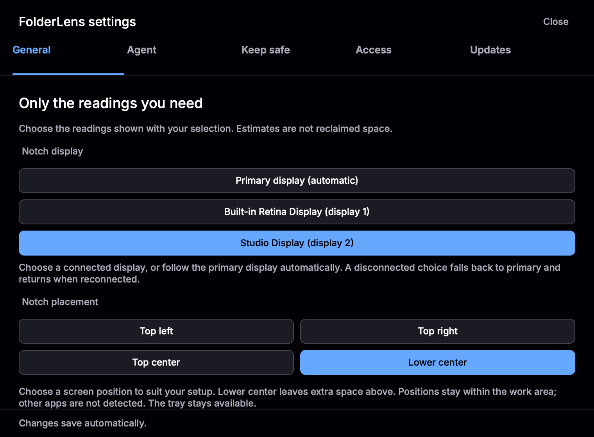
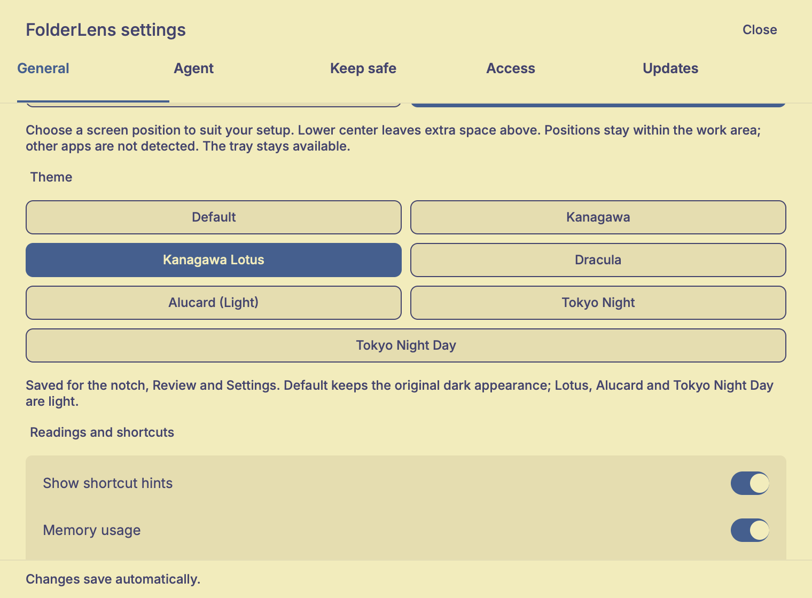

# FolderLens


A notch-first macOS app for reviewing cleanup candidates, disk space and system usage, with optional agent analysis and a menu-bar fallback.

**Record choice records a selection in memory. It never deletes files or runs cleanup.** Sizes are estimates, not reclaimed space.

FolderLens is the new name for Shelf, starting with **0.2.1**. Quick review, folder protections, manual agent help and publisher-verified update checks remain available. The [codebase map](.planning/codebase/ARCHITECTURE.md) documents the pre-rename source.


## Install

Apple Silicon, macOS 14+. Get the DMG or ZIP containing `FolderLens.app` from the [0.3.4 stable release](https://github.com/jellydn/folderlens/releases/tag/v0.3.4) and check `SHA256SUMS`. Builds are ad-hoc signed, **not notarized**; macOS may require **Privacy & Security → Open Anyway**. Publisher signatures are not Apple approval.

Or install the stable release through Homebrew. Version 0.2.1 and later install `FolderLens.app`; older cask versions installed `Shelf.app`. The cask checks for new stable versions every six hours, so it can lag behind a new release. Run `brew update` first.

```sh
brew install --cask jellydn/tap/folderlens
```

For Homebrew trust or source builds, see the [guide](docs/guide.md#install). Existing Shelf users must follow the [migration guide](docs/guide.md#migrating-from-shelf); the old updater cannot accept FolderLens-named releases.

## Use

1. Expand the notch and choose **Review / AI**, or click the menu-bar archivebox. Choose a preset or eligible folders; review reasons and exclusions.
2. **Record choice** records without deleting. Selection changes clear the record.
3. For **Ask Agent**, configure **Settings → Agent / Access**. Requests are manual; provider costs and data policies apply.

### Notch and local checks

By default, the app starts with a compact notch below the primary display's
camera/menu-bar area. **Version 0.3.3** reduces the compact view to
**300×32 points**, keeping the metrics and 22×28-point expand control. Published
0.3.1–0.3.2 use 300×36 points; 0.3.0 used 360×36.

**Themes in 0.3.3:** **Settings → General → Theme** applies to the notch,
Review and Settings. Choose **Default**, **Kanagawa**, **Kanagawa Lotus**,
**Dracula**, **Alucard (Light)**, **Tokyo Night** or **Tokyo Night Day**.
Default preserves the original dark colors; Lotus, Alucard and Day are light.
The choice saves automatically and survives restart. Missing or unknown values
use Default. FolderLens owns its settings; it does not read or change Oak's.
Settings changes without a color fade; Review and the notch pick up the saved
theme on the next poll (up to about one second while hidden). A theme-only change
keeps Record choice intact. These are fixed palettes, not automatic system matching.

**Position controls in 0.3.2:** **Settings → General → Notch placement** offers
**Top left**, **Top center**, **Top right** and **Lower center** (default).
These are screen positions, not presets for another app. Left/Right sit near the
visible work area's edges; both panel sizes remain within that area. Lower center
keeps the existing extra space above. Placement follows the selected display and
updates after expansion or display changes. If the expanded panel cannot fit, it
collapses; if compact cannot fit, it hides in favor of the tray. Choose a different position if another
app overlaps; FolderLens does not detect apps or reserve their assumed sizes.
The old 0.3.1 switch migrates to Lower center when on, Top center when off.

**Display selection in 0.3.4:** **Settings → General → Notch display** lists
connected displays by name. Choose one, or leave **Primary display (automatic)**
selected. FolderLens remembers the display independently of its name or list order.
If it disconnects, the notch uses the primary display and returns when the saved
display reconnects. Choose Primary to forget the saved choice. Existing settings
keep the automatic primary behavior. Position and theme remain unchanged, and
display-only changes preserve Record choice. Both notch sizes use the chosen
display's visible work area; the tray remains the fallback if compact cannot fit.



The single-line compact view uses icons for candidate estimates, disk
free/total space, CPU and memory usage, plus a scan-status dot. Expand it for Scan now,
30-minute/1-hour checks and Run/Pause. CPU and memory follow General settings.
**Review / AI** opens the full folder review; closing Review returns to the notch.
**Use tray** hides the notch. The archivebox remains available as a fallback to
open Review, including while Settings is open. Escape collapses the notch first,
then hides it. Closing Settings returns to the notch.

To quit, expand the notch and choose **Quit**, or open Review from the tray and
choose **Quit** in the fixed readings footer. **Actions → Quit FolderLens** and
**Command-Q** also quit. **Close** and **Use tray** only hide a surface; scans
continue while the app is open. Quitting stops interval checks and the scan worker;
no scan daemon or scheduled task remains. Relaunch starts intervals paused.




Named palette families follow [Oak's theme choices](https://github.com/jellydn/oak/blob/main/Oak/Oak/Models/AppTheme.swift):
[Kanagawa](https://github.com/rebelot/kanagawa.nvim),
[Dracula/Alucard](https://github.com/dracula/dracula-theme) and
[Tokyo Night](https://github.com/folke/tokyonight.nvim). Text, muted and warning/error
colors and light accents are adjusted for compact-app contrast, not copied as editor defaults.

The review panel shows cleanup-candidate estimates, disk free space and a
live CPU meter. Candidates are for review, not a promise of safely reclaimable space.
No agent is needed to scan, select folders or record a choice.

Use **Scan now** to refresh measurements. Select **30 min** or **1 hour**, then
**Run** for repeated local scans. **Pause** stops future scans; an active scan
finishes. Checks run only while FolderLens is open, never overlap, and start
paused after a restart. Changing the interval or resuming starts a full interval.
Intervals never launch AI or cleanup. These controls are available starting with 0.3.0.

**Actions** opens folder controls and Settings. The panel stays open across outside clicks and update dialogs. Use **Close**, Escape or the menu-bar button to hide it; Escape closes Actions first.

## Feature gallery

These current Rune renders use example Agent states, not real model turns or native popup verification. [Full gallery](docs/guide.md#feature-gallery-beta5) covers review/recording, folder actions, General, provider/model Apply, selected-path access, protection, Agent progress/Cancel, errors/Retry, saved chat and Updates. Filled buttons mark the main action; secondary actions are outlined, and removing an exclusion uses a warning style. Record choice never deletes.

| Agent setup and model | Updates and manual-install policy |
| --- | --- |
|  |  |

## Updates

**Settings → Updates → Check for Updates…** offers **Download → verify → Reveal in Finder**. Extract the verified ZIP, quit FolderLens, then replace the app manually. Preferences and chats are stored separately and are not removed. FolderLens never replaces or restarts the installed app; Homebrew users use `brew upgrade --cask jellydn/tap/folderlens` instead.

## Limits

- Folder sharing is opt-in and selected-only. Context may leave your Mac and persists locally. Provider controls are not an OS sandbox.
- Tests/headless renders are not native end-to-end proof. Tray routing, model/tool turns, Terminal continuation and real install/restart/Gatekeeper behavior remain unverified. Cleanup safety is not established.
- Settings→tray reopening remains a separate known issue; the popup changes do not establish a fix for it.

## Details

[Full guide and historical screenshots](docs/guide.md) · [Agent boundary](docs/adr/0001-scoped-agent-sessions.md) · [Update policy](docs/adr/0002-publisher-verified-updates.md) · [Release notes](RELEASE_NOTES.md)

## Build and test

```sh
sh scripts/bundle.sh
cargo test --locked
```

### Amp orbs

`.agents/setup` installs the pinned Rust toolchain with rustfmt and Clippy, then
fetches the locked dependencies into Cargo's cache. Amp can reuse these tools and
dependencies in project snapshots. It uses the Node.js supplied by the orb; no
JavaScript package installation, agent account, or secrets are needed.
`.agents/resume` checks tool availability without installing anything on wake.

Linux orbs can run `cargo fmt --check` and `node --test tests/pi-reader.mjs`.
Use a Mac satellite for native builds, Rust tests, Clippy, app renders, and
packaging. The Linux dependency cache does not replace a Mac's own toolchain or
build cache.

Built with Rust and Rune. [MIT license](LICENSE).
