# FolderLens guide

Detailed implementation, usage and verification notes. Start with the [short README](../README.md).


> FolderLens reviews folder selections. Record choice records a choice; it does not delete files or run cleanup.

## Current status

FolderLens is the new name of Shelf, starting with **0.2.1**. It is not a cleanup engine. Careful, Balanced and Aggressive presets preview which items are selected and their estimated footprint. **Record choice only records a choice in memory; FolderLens does not delete the selected files.** Changing the selection or its exclusions clears the recorded indicator. An empty selection cannot be recorded.

The app includes manual Ask Agent adapters, per-agent model settings, a bounded selected-folder reader, saved-session launchers and signed-update checks. Protocol stubs, headless UI tests and limited native metadata/download checks exercise these implementations. They do **not** establish end-to-end native model analysis, tool routing during a model turn, Terminal continuation, tray event routing, or actual update installation/restart and Gatekeeper behavior. Earlier screenshots, releases and history remain available; they are not evidence of completed safety review.

<a name="quick-review-beta4-preview"></a>

## Quick review (0.3.2)

Quick review has short labels, explicit Close controls, folder reasons, protection rules and optional Agent help.

### Notch and local checks

Starting with 0.3.1, FolderLens uses an Oak-style notch: 300×36
points collapsed, 480×230 expanded. Version 0.3.0 used 360×36.

**Starting with 0.3.2:** **Settings → General → Notch placement** has four choices:

- **Top left / Top right:** 8 points from the visible work area's side, below the
  camera/menu bar. Expansion keeps the same edge anchor.
- **Top center:** centered on the primary display, just below the camera/menu bar.
- **Lower center:** the default, with the existing 41-point extra top inset.

Both panel sizes have origins clamped to the visible work area. Center positions
use the full display's center, not the Dock-reduced area's center. Placement updates
after expansion and display changes, including screens without physical notches.
If the expanded panel cannot fit, it collapses. If even the compact panel cannot
fit, the notch hides and the tray remains available.
These controls are independent of other apps: no app detection, assumed app sizes,
reserved center slot, dragging, display selection or automatic collision handling.
Choose another position if a different app overlaps.

Old `notch_below=1` settings become Lower center; `notch_below=0` becomes Top center.
An explicit `notch_position` wins over the legacy
key in either order. Missing/unknown positions keep the legacy choice or default
to Lower center. The archivebox fallback always remains available for Review and Settings.

The compact view uses one
line: folder (eligible candidate estimate), disk (free/total), CPU and memory icons with values, and
a status dot (blue while running/scanning, gray while paused). Hover the dot for
the exact scan state and the disk reading for its full label. CPU and memory preferences
apply to both surfaces. Missing readings
show as unavailable, not zero. Expand for the same local scan controls as Review; **Review / AI**
opens the full folder list and manual agent controls. No second scanner runs.

**Quit** is visible in the expanded notch and in Review's fixed readings footer
(including the tray fallback). Actions → Quit FolderLens and Command-Q remain
available. Quit exits the whole app, stops interval scheduling, disconnects the
scan-request channel and cancels any manual agent job/reader. In-process scan and
gauge workers end with the process; there is no background scan service. Close and
Use tray only hide windows. Relaunch starts interval scans paused.

**Use tray** or Escape from the collapsed notch hides it; the archivebox is the
fallback to open Review. Close Review or Settings to return to the notch. Opening
Review hides the notch; opening Settings hides both. Outside clicks do not dismiss
these persistent surfaces. Tray event routing and physical-notch hardware still
need native manual checks; headless renders alone do not establish those results.

Render synthetic notch scenes with `--window notch --scene compact-example`, or
`--window notch --scene expanded-example --size 480x230`, plus `--theme dark --snap`.
`running-example` and `scanning-example` show the other expanded states.

The panel uses Oak's near-black surfaces and blue selected controls. The overview
shows the estimated footprint of eligible cleanup candidates, free disk space and
a live CPU meter. The CPU reading option in General settings also controls this
meter. Candidate estimates do not establish that deleting the folders is safe.

**Scan now** refreshes folder measurements on a background worker. For repeated
local checks, choose **30 min** or **1 hour**, then **Run**. The first interval
starts when Run is pressed; each later interval starts after the previous scan
finishes. **Pause** prevents future checks, but lets an active read-only scan
finish. Resume and interval changes start a new full interval. Checks do not
overlap or replay a backlog of missed intervals. They continue when the panel is
hidden, require the app to stay open, and start paused at 30 minutes after relaunch.
Command-P and the Actions menu control the same Run/Pause state.

The startup scan can reuse the size cache. Explicit and interval scans remeasure
nested contents. A successful refresh clears Record choice, preserves explicit
ticks by folder path and open groups by identity, and reapplies current exclusions
and live-reader scope. A failed refresh keeps the previous catalog. Scan controls
need neither an AI provider nor agent-start permission. **Ask Agent** remains a
separate manual action through the existing adapters; intervals never make model
requests, paid or otherwise. No cleanup command or deletion path is added.

The main actions use filled buttons: Record choice, Apply model and update checks. Secondary actions are outlined; navigation is quiet; removing an exclusion uses a warning style. A recorded choice becomes secondary. Empty-selection buttons are muted, do not take focus and have no press handler. Enabled buttons support Tab/Space, hover/press feedback and a visible focus ring. Agent protocol lines are capped before parsing, the message queue is bounded and newline bytes count toward the diagnostic log budget. Completed reports have a 256 KiB limit.

The panel opens from the menu bar and stays open across pointer movement, outside clicks and transient update dialogs. Use **Close**, Escape or the menu-bar button to hide it. Escape closes Actions first. Settings also has Close and Escape. The native update helper orders out its alert and restores its presenter's focus without reopening a window that was explicitly closed. Policy/callback regressions cover dismissal; headless renders do not prove the full native popup flow.

**Known native issue:** beta.3 testing observed that the tray could stop reopening the ledger after Settings opened. The cause and a native fix are not verified. A later isolated diagnostic run also failed its initial tray-open control, so it does not establish a Settings-specific cause. Headless navigation tests do not verify AppKit event routing.

The wide panel puts folders beside optional Agent help. Below 620 points, Agent help precedes the folders in one scrollable column. **Record choice** stays visible with the selection count, estimated footprint and explicit non-deleting status. Live system readings stay below it. These panel examples use synthetic data and make no scan, model request or file change.

<a name="feature-gallery-beta5"></a>

## Feature gallery (current source)

All current images below are headless Rune GPU renders. Folder examples and Agent progress/error/saved-chat states are fixtures, not native model turns or popup tests. Settings reflects example configuration, not proof of login, free access or a working provider. Scrolling and keyboard behavior are tested separately.

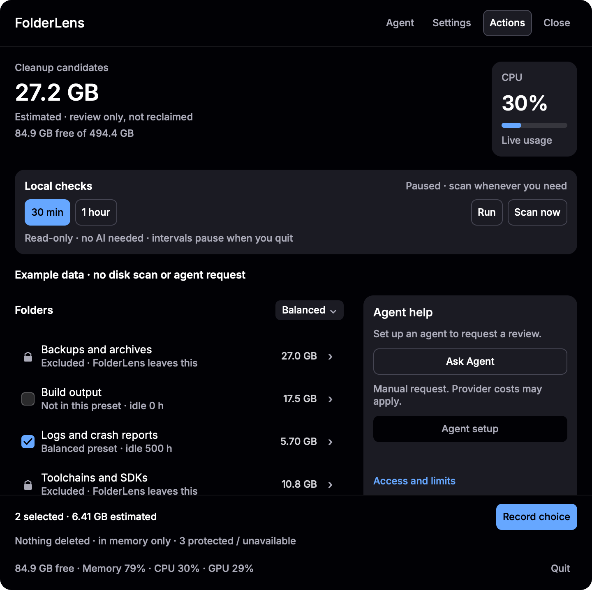

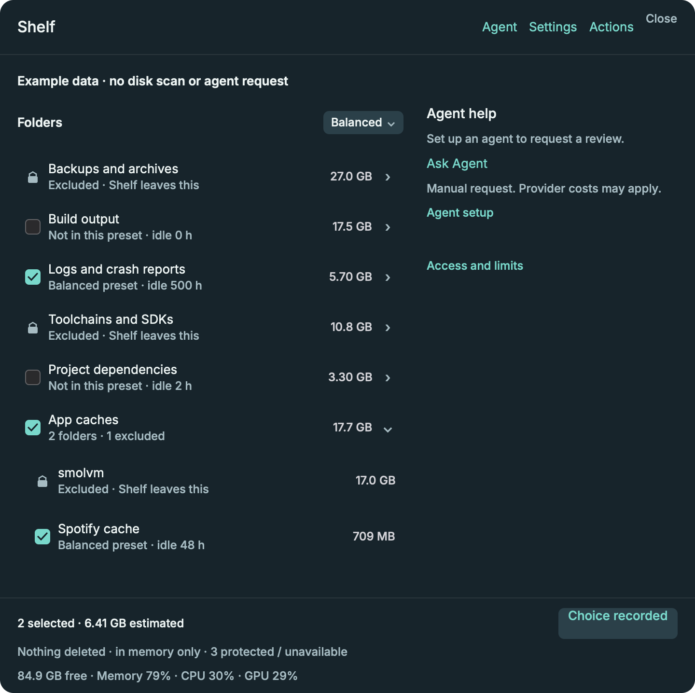

Folder actions show the target and its reason. Ask Agent still uses the eligible selection, not the action target. Protected settings explain user exclusions, recent-change holds and built-in exclusions separately; their rules are unchanged.

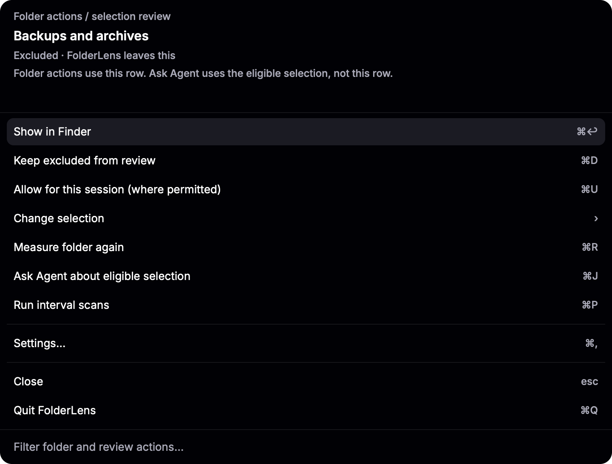

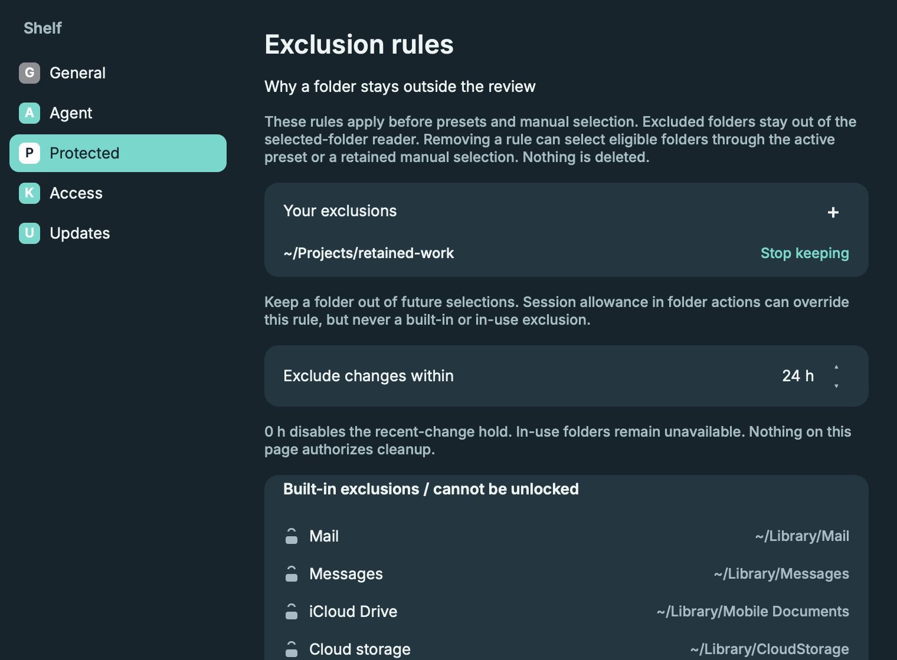

Settings uses General, Agent, Keep safe, Access and Updates tabs. Agent shows the configured executable, per-provider model and explicit request/path-sharing permissions. **Apply model** stays visible while the page scrolls; switches save immediately. **Change agent / advanced setup** reveals detected commands, the custom executable and saved-file details. Access retains the same permission switches and system-access information. Detection does not verify login, model access or a working native session.

The fixed **Agent** entry scrolls to Ask Agent or the current review's progress, Cancel and result. **Agent setup** opens provider configuration. **Access and limits** expands the configured provider/model and safety limits. **Run files in Finder** opens an existing request's folder only when clicked. **Continue saved chat in Terminal** appears only after a successful review; a running or failed request has no completed session to continue. These controls do not change the selected-folder broker or provider safety rules.

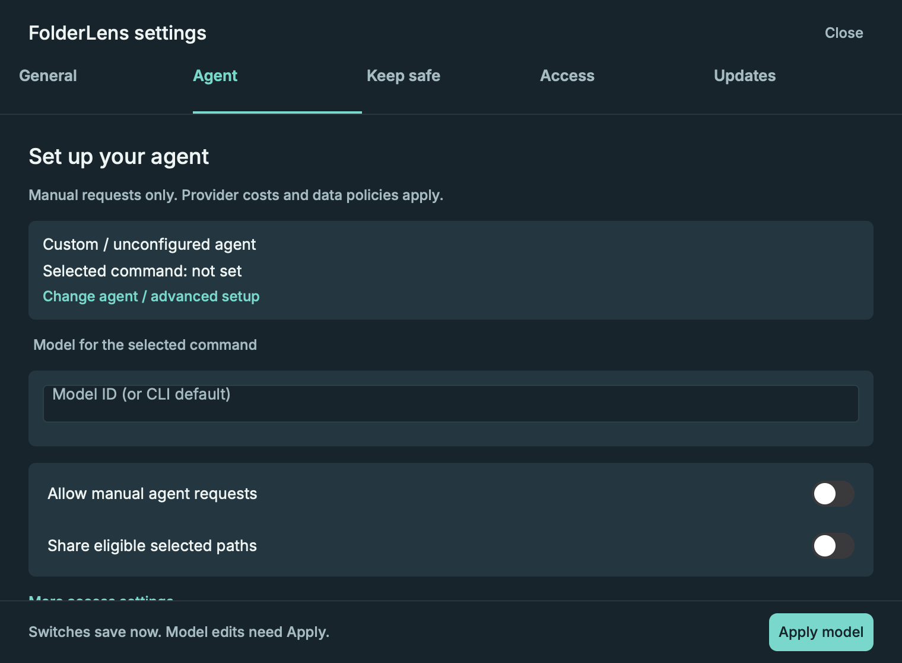

| General readings | Selected-folder access |
| --- | --- |
| 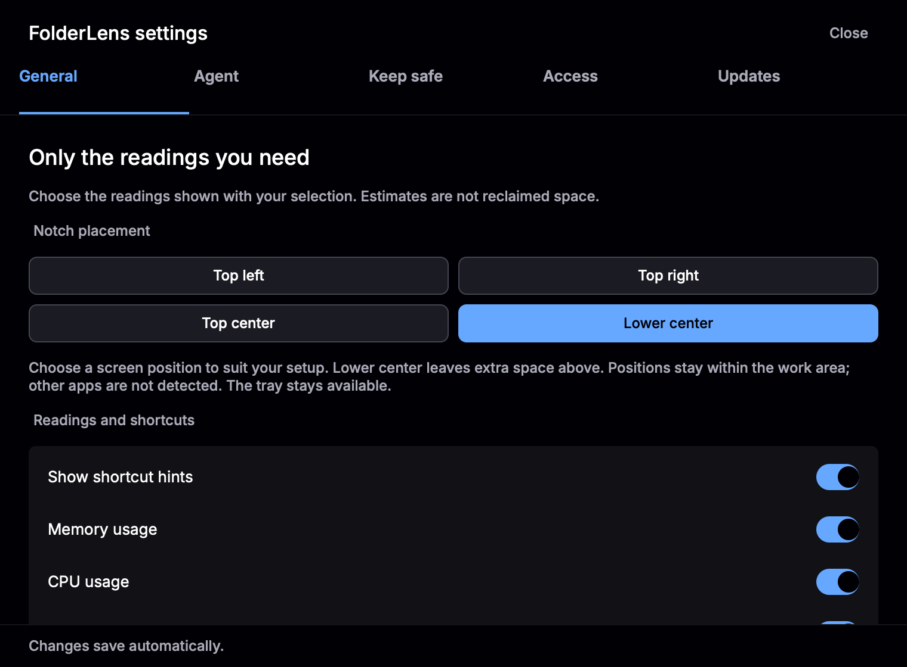 | 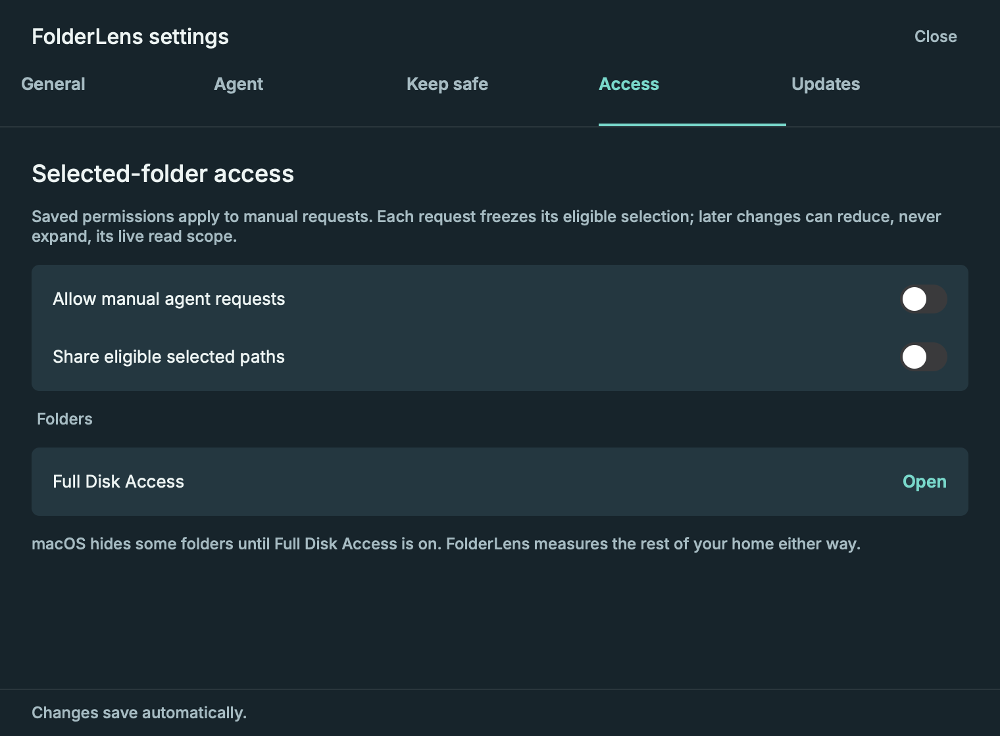 |

| Progress and Cancel — simulated | Error, details and Retry — simulated |
| --- | --- |
| 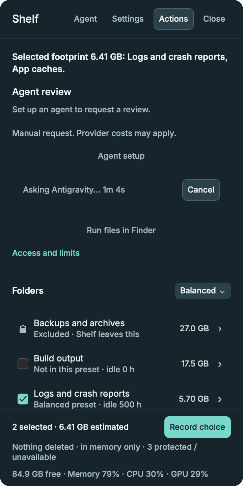 | 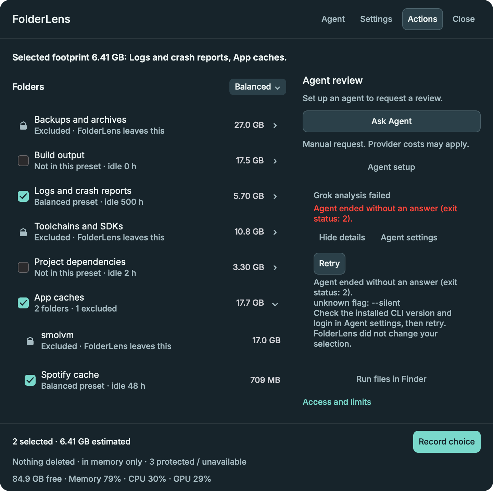 |

| Successful review and saved chat — simulated | Updates and manual-install limits |
| --- | --- |
| 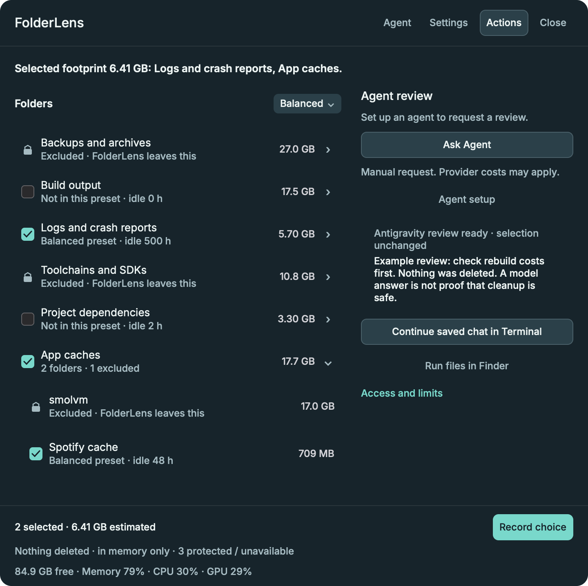 | 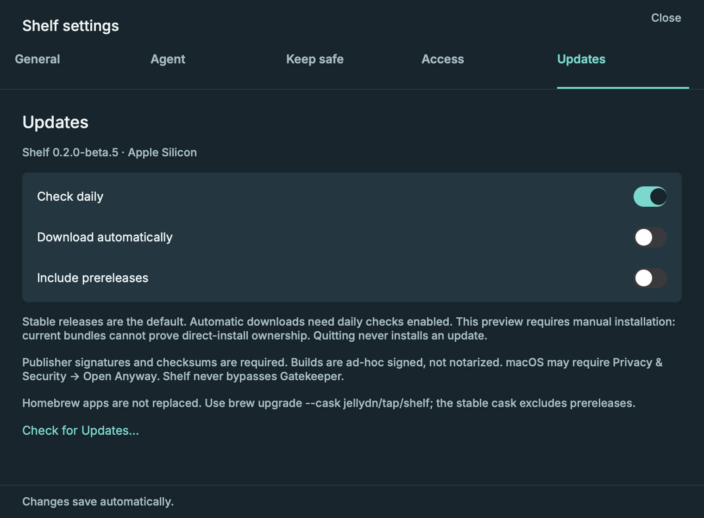 |

## Earlier screenshots and provenance

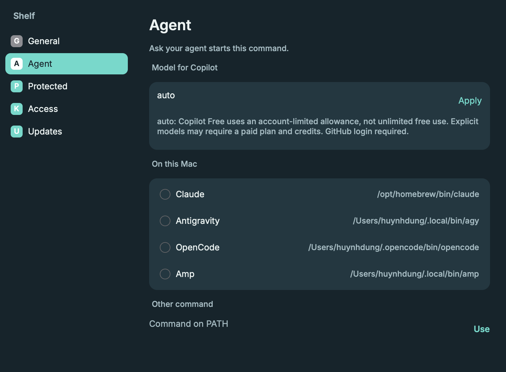

Historical presentation: [original panel](../shots/tray.png), [original Protected settings](../shots/settings-protected.png), [earlier Agent settings](../shots/settings-agent.png). These files remain unchanged.

## Brand assets

The bundled app uses [FolderLens.icns](../assets/FolderLens.icns), generated from the Painter-designed [app icon](../assets/folderlens-icon.png). The matching small-size [favicon](../assets/favicon.svg) uses the same teal, amber and cream shapes. [ICO](../assets/favicon.ico), [PNG](../assets/favicon.png), Apple touch/PWA icons and [web manifest](../assets/site.webmanifest) are in `assets/` for documentation sites; GitHub controls its own browser favicon. Regenerate with `uv run --with pillow scripts/icons.py` on macOS. Normal builds copy the committed ICNS and need no image-generation tools.

## Features

- Menu-bar review ledger with compact live memory, CPU, GPU and free-space readings
- Candidate selection reasons, exclusions and an estimated-footprint receipt; no reclaimed-space claim
- Careful, Balanced, and Aggressive presets, plus a Selected override
- Record choice keeps an in-memory choice, not a cleanup instruction
- Actions for the row under the pointer: Finder, keep, unlock, and the rest
- Protected folders you add, a “keep what changed within” hold, and built-in locked paths
- AI tools detected on `PATH`, from the same command list as [ai-launcher](https://github.com/jellydn/ai-launcher)
- Ask Agent sends the current ticked selection, sizes, and cleanup request to the tool chosen in Settings, only after you grant access. Folder paths are sent only when path sharing is enabled; destructive work needs approval.
- Settings and the panel are never open together

## Ask Agent (experimental)

Each request creates a private folder under `~/Library/Application Support/FolderLens/Runs/` with `Ask.command` and `context.md`. Earlier runs are kept, not overwritten. The context records the eligible ticked items at the time of the request; later selection changes do not change that snapshot.

Ask Agent runs the configured CLI on a background thread. Grok, Antigravity, GitHub Copilot CLI and OpenCode use ACP; Pi uses RPC. Other agents show an unsupported-provider message; FolderLens does not switch agents or guess their flags. The panel shows elapsed progress and Cancel, then the review or an inline error. Details shows redacted diagnostics, with Agent settings and Retry. Errors do not clear scan results or change ticks.

In **Settings → Agent**, enter a model ID and select **Apply**. FolderLens remembers a separate choice for each agent (and each custom executable). Switching agents restores that agent's saved model. Grok, Antigravity, Copilot and Pi receive provider-supported `--model` arguments. OpenCode receives private per-run configuration and an ACP model selection, not a nonexistent top-level model flag. FolderLens checks advertised model access before prompting; an unavailable explicit model fails instead of silently choosing another model. Blank keeps the CLI default, except Copilot uses `auto` and OpenCode requires an explicit model.

| Agent | Interface and model example | Access and cost limits |
| --- | --- | --- |
| Grok / Antigravity | ACP plan mode; optional model ID | Your existing CLI login, default model, plan and sandbox apply. |
| GitHub Copilot CLI | ACP plan mode; `auto` | [Copilot Free](https://docs.github.com/en/copilot/concepts/billing/usage-based-billing-for-individuals) has a limited allowance and Auto-only model access. Explicit models depend on your plan and credits; Auto is not a promise of free use on a paid account. |
| Pi | RPC; `openrouter/openrouter/free` | Pi provides no inference entitlement. [OpenRouter Free](https://openrouter.ai/openrouter/free) needs your account/key; rate limits, routing and each model's data policy apply. Blank may use a paid CLI default. |
| OpenCode | ACP, verified configuration schema **2.0.23 only**; `opencode/glm-5.3-flash-free` or `opencode/deepseek-v4.1-flash-free` | [OpenCode's free models](https://opencode.ai/docs/zen) are temporary and account/availability limits apply. Privacy terms differ by model. FolderLens pins the chosen model for title/compaction as well and does not select a paid fallback. Other CLI versions fail closed until their configuration is verified. |

No shared provider configuration is changed. Use the provider's own login/key setup; do not enter credentials in FolderLens's model field. Sending context to an agent can send it to an external model provider, including when the model is free. Check your provider's data policy and budget before starting a review.

With path sharing off, FolderLens sends only the saved selection context. With sharing on, FolderLens permits bounded text reads and directory listings for eligible selected folders. Its reader rejects writes, commands, unselected paths, protected/kept/held/in-use paths, and symlink escapes. Reads are limited to 512 KiB of UTF-8 text, 2,000 lines, or 1,024 directory entries. Selection or permission changes can only reduce the original read scope.

Copilot and OpenCode use FolderLens's private MCP reader; Pi loads only the explicit FolderLens reader extension, with native tools and discovered extensions disabled. These adapters deny native ACP read/permission requests so they cannot bypass the broker. OpenCode waits for its private read-only mode to finish loading before selecting a model or sending a prompt. The private reader permits only original ∩ current eligible selection. Its socket closes on cancellation, failure, replacement or app exit. Saved chat can continue without FolderLens, but these folder tools fail closed; reopening FolderLens does not restore old grants. Grok/Antigravity analysis uses the same bounded reader through ACP callbacks; their Terminal continuation still relies on their native plan/sandbox controls. Provider controls and callbacks are not an independent operating-system sandbox.

After a successful review, FolderLens saves `analysis.md` and `session.txt`. Terminal opens `Ask.command` to resume that exact provider session in the same run folder, with the same model and tool restrictions. Pi must finish its settled event and save its exact chat under the run's private `sessions/` directory. Before success, the launcher refuses to open an unrelated fresh chat. FolderLens rechecks the agent, model and start permission before opening Terminal. The saved context is a snapshot, not a live selection.

OpenCode continuations recheck the verified CLI version even when FolderLens is closed. Pi blocks continuation prompts if the restored model differs from an explicit saved choice. Cancellation and successful review finalization have one ordering point: cancellation that wins prevents a successful report/session launcher from being saved.

Agent-start permission still applies. Requests remain manual; there are no automatic paid calls. Destructive work requires separate approval, and FolderLens itself never deletes files. Run files can contain shared paths and remain on disk until you remove them. On this Mac, the installed Grok read-only sandbox currently refuses startup because of a socket-symlink deny-list error; FolderLens reports it rather than disabling the sandbox. Harmless native metadata checks verified Copilot's plan/Auto selection, Pi's model state, and OpenCode's private-mode loading and exact model selection without sending a model prompt. Live model analysis, native tool routing during a model turn, and native Terminal continuation have not been verified; protocol stubs cover the handoff and failures.

## Updates

Settings → Updates checks GitHub releases daily while the bundled app runs. Stable releases are the default; **Include prereleases** is opt-in. **Download automatically** is off by default and requires daily checks to be enabled. Manual checks remain available. Updates send only an app/version request to GitHub, never scan results, selected paths, saved chats or agent credentials.

FolderLens verifies signed `update.json` metadata against its pinned, dedicated Ed25519 public key, then verifies the ZIP's signed size and SHA-256 before extraction. Expired metadata, missing/wrong signatures, wrong channel/version, corrupted downloads and unverified bundles fail closed. Every **Install and Restart** action requires a separate native confirmation; a download or quitting FolderLens never authorizes installation. Finish agent reviews first. A previous app copy is kept next to the installation for rollback. App settings and chats are not removed.

Detected Homebrew installations are not self-replaced: use `brew upgrade --cask jellydn/tap/folderlens`. The stable tap does not follow prereleases. Source/debug binaries do not run an updater; use the bundled app.

**Unknown installation origin is manual-update-only.** A missing cask receipt, a writable Applications path or a copied bundle marker is not proof of a direct installation. This also blocks native replacement for custom-prefix casks launched by Finder without `HOMEBREW_PREFIX`, moved cask apps and aliases. Current packages have no reliable direct-install provenance, so **native Install and Restart is unavailable for all current installations**, even with user approval. Only a future positively established eligible direct installation may reach the separate confirmation and tested installer; no preference bypass exists.

Publisher-verified checks and opt-in downloads still work. After an automatic download, use **Check for Updates…** for manual-install guidance; verified ZIPs are in `~/Library/Application Support/FolderLens/Updates`. If Homebrew installed FolderLens, update through Homebrew rather than replacing the app manually. Otherwise install the verified ZIP or release DMG yourself, subject to normal macOS approval. Discovery currently examines the first 100 releases. There is no persistent download-ready indicator. Old rollback copies are retained rather than automatically deleted. These non-blocking preview limits are recorded in PR #10.

**Published beta.1 limitation:** its native archive transfer timed out during post-release verification. Use the release's DMG or ZIP for manual installation if an update download fails. PR #10 replaces the per-byte archive loop with a native file transfer; this fix is not in the published beta.1 assets. Signed-asset verification passed, but real app replacement/restart remains unverified.

Signing follows [Oak's](https://github.com/jellydn/oak) per-app public-key/Actions-secret pattern and pinned Sparkle signing tools. FolderLens uses its **own** `SPARKLE_PRIVATE_KEY` secret, not Oak's key. Unlike Sparkle's silent install-on-quit mode, FolderLens separates downloads from an explicitly approved native installation. Release publication requires valid publisher signatures on metadata, ZIP and DMG. No Apple Developer account is required for these signatures, but they are **not Developer ID signing or notarization**. First installation or a later restart may need macOS **Privacy & Security → Open Anyway**; FolderLens never clears quarantine or disables Gatekeeper. Translocated or non-writable installations also require manual installation; moving the app to a writable location does not establish ownership.

Update metadata expires one year after signing. Publish a new release or explicitly refresh and re-sign its metadata before expiry. Keep the pinned key stable; losing the signing key requires a separately verified manual installation, not an unsigned fallback. Install/restart behavior and native agent model turns must not be described as verified until exercised on the real path; test coverage is recorded in each PR/release.

## Prerequisites

- macOS
- Rust, pinned in `rust-toolchain.toml`

## Install

For Apple Silicon Macs running macOS 14 or later, get the DMG or ZIP containing `FolderLens.app` from the [0.3.2 stable release](https://github.com/jellydn/folderlens/releases/tag/v0.3.2). Check `SHA256SUMS`. Existing Shelf releases and assets are not replaced.

Or install the stable release through Homebrew. The `folderlens` cask installs `FolderLens.app` starting with 0.2.1. It checks for new stable versions every six hours and can lag behind publication; run `brew update` first:

```sh
brew install --cask jellydn/tap/folderlens
```

If Homebrew refuses to load an untrusted third-party cask, review `jellydn/homebrew-tap` and run `brew trust --cask jellydn/tap/folderlens`, then retry installation. This trusts only FolderLens, not every entry in the tap. Older Homebrew versions may not require this step.

The app is ad-hoc signed, not notarised. If macOS blocks the first launch, use **System Settings → Privacy & Security → Open Anyway**. Intel builds are not provided yet.

To build from source:

```sh
git clone https://github.com/jellydn/folderlens
cd folderlens
sh scripts/bundle.sh
open target/release/FolderLens.app
```

Copy `target/release/FolderLens.app` to Applications if you want to keep it there. The bundle uses `io.github.jellydn.folderlens` as its stable identifier and `LSUIElement` to stay out of the Dock. The build script signs it ad hoc for local use; it is not a notarised release.

### Migrating from Shelf

The published Shelf 0.2.0 updater accepts only Shelf-named ZIPs. It cannot be changed by the new release and rejects FolderLens-named manifests before showing migration guidance. Use the release page or the source-build steps above, not the old in-app updater, for the first FolderLens installation. No automatic replacement is enabled.

- Quit Shelf before opening FolderLens. For a direct download, verify the new release and install `FolderLens.app` manually alongside the old app first. After checking your settings, you can remove the old app yourself; FolderLens never removes it.
- For Homebrew, run `brew update`, then `brew upgrade --cask jellydn/tap/folderlens`. Confirm the cask reports 0.2.1 or later; 0.2.0 still installs Shelf. If Homebrew still records the old `shelf` token, inspect `brew list --cask` and use Homebrew's cask migration/reinstall path; do not overwrite a Homebrew-managed app manually. Keep a backup of settings and chats and do not use `--zap`.
- On first load, absent `FolderLens/settings.txt` settings are imported from `~/Library/Application Support/Shelf/settings.txt`, including exclusions, the recent-change hold, provider/model choices and permissions. An existing FolderLens file always wins. The legacy file is left intact; if the new file cannot be saved, legacy settings still apply for that session.
- Saved conversations stay in `~/Library/Application Support/Shelf/Runs/`; they are not moved, deleted or silently rewritten. Old launchers refer to the old executable and provider controls. Keep Shelf if you need them, or read the saved context/analysis directly. Start a new FolderLens review for new live-read grants; old grants never revive.
- Folder sizes are remeasured into the new cache. Downloaded Shelf updates stay in the old `Updates/` folder. The new bundle ID is `io.github.jellydn.folderlens`, not `io.github.jellydn.shelf`; macOS may require a new Full Disk Access grant and normal Gatekeeper approval. Publisher-key continuity is retained, not rotated. Install/restart and permission migration have not been verified on an existing user installation.

The archivebox icon appears before the disk scan finishes. Click it to open the panel. In beta.5, outside clicks and pointer movement leave the panel open. Use Close, Escape or the menu-bar button to hide it; Escape closes Actions first. On macOS 27, the panel uses AppKit's expanded-interface session; older systems use the button action. Native event routing remains unverified.

The first scan and system gauge commands run on background threads. Memory, CPU, and GPU update about once a second. GPU load comes from the driver's IOKit performance statistics, with renderer/tiler values as a fallback when device utilisation is unavailable. A driver that exposes no load still shows 0%.

For development, `cargo run --release` still works without building a bundle.

CI checks formatting, Clippy, and the full test suite, then uploads packaged test apps. A `v*` tag matching `Cargo.toml` runs the release workflow and publishes an Apple Silicon DMG, ZIP, and `SHA256SUMS`. Packaging follows [Oak's](https://github.com/jellydn/oak) ad-hoc sign/verify-before-archive approach. Update `RELEASE_NOTES.md` before each release. The Homebrew tap checks for published stable releases every six hours and can also be updated manually.

Open Settings from Actions, or with Command-,. The panel closes. Click the menu-bar icon to close Settings and open the panel.

Choose **Quit FolderLens** in Actions, or press Command-Q in the panel or Settings, to exit the app.

## Run tests

```sh
cargo test
```

A headless picture of the panel:

```sh
cargo run -- --theme dark --scene ledger-example --snap shots/review-ledger.png
```

## Architecture and decisions

Start with the [architecture map](../.planning/codebase/ARCHITECTURE.md). The same directory covers the stack, integrations, structure, conventions, testing and known concerns. [Agent guidance](../AGENTS.md) remains the operating reference.

- [Scoped agent sessions and per-agent model configuration](adr/0001-scoped-agent-sessions.md)
- [Publisher-verified updates, channels and install approval](adr/0002-publisher-verified-updates.md)

## Author

👤 **Huynh Duc Dung**

- Website: https://productsway.com/
- Twitter: [@jellydn](https://twitter.com/jellydn)
- Github: [@jellydn](https://github.com/jellydn)
